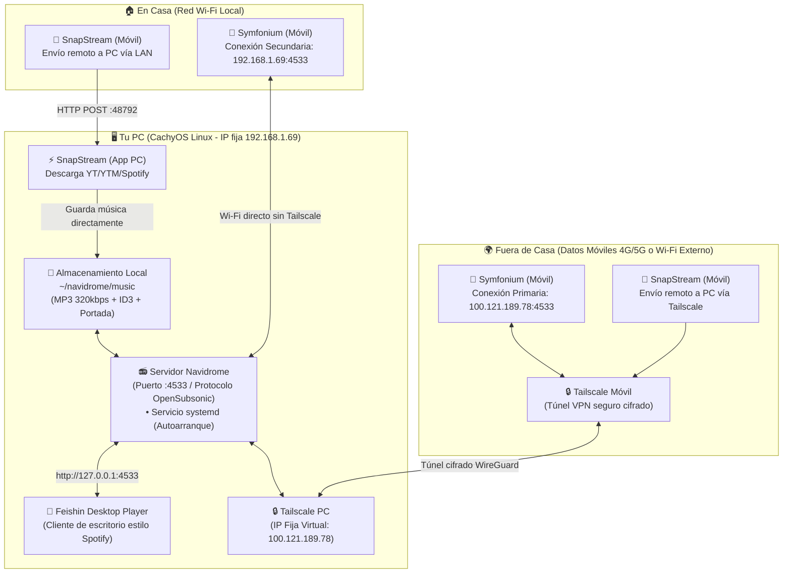

# 🎧 Arquitectura del Ecosistema Personal de Música y Descargas

Este documento resume la arquitectura final y funcional de tu infraestructura de música privada, eliminando las pruebas y soluciones descartadas.

---

## 🏛️ Diagrama de Arquitectura Global

---

## 🧩 Componentes del Sistema

### 1. Servidor Central de Música: **Navidrome**
* **Función:** Indexa tu carpeta `~/navidrome/music` y sirve la música a través del estándar **OpenSubsonic**.
* **Persistencia tras reinicios:**
  * Configurado como servicio de usuario en `systemd` (`systemctl --user enable navidrome`).
  * Activado `loginctl enable-linger` para que se inicie automáticamente apenas arranca la PC sin requerir login interactivo.
* **Puerto:** `4533`
* **Credenciales:**
  * Usuario: `RayoPeronizador`

---

### 2. Reproductor de Escritorio: **Feishin**
* **Función:** Reproductor de música en PC con interfaz moderna y rápida (estilo Spotify).
* **Conexión:**
  * **Tipo:** Navidrome
  * **URL:** `http://127.0.0.1:4533`
  * **Usuario:** `RayoPeronizador`

---

### 3. Conectividad Segura y Permanente: **Tailscale**
* **Función:** Conecta tu móvil y tu PC desde cualquier lugar del mundo de forma segura y cifrada sin abrir puertos en el router.
* **IPs definitivas fijadas:**
  * **IP Externa (Tailscale):** `100.121.189.78` *(Fija para siempre).*
  * **IP Local (Ethernet en casa):** `192.168.1.69` *(Fijada en modo manual mediante NetworkManager).*
* **Ajuste clave en Android:**
  * Desactivado **"Use Tailscale DNS"** para que tus datos móviles y Wi-Fi sigan funcionando con normalidad a máxima velocidad mientras escuchas música.

---

### 4. Reproductor Móvil: **Symfonium**
* **Función:** Reproduce tu música en Android con soporte para carátulas HD, listas, ecualizador y descargas offline opcionales.
* **Doble Conexión Configurada:**
  * **Conexión Primaria (Fuera de casa):**  
    `http://100.121.189.78:4533` (activa Tailscale en el móvil).
  * **Conexión Secundaria (En casa):**  
    `http://192.168.1.69:4533` (funciona directo por tu Wi-Fi sin necesidad de prender Tailscale).

---

### 5. Descargas Automatizadas: **SnapStream**
* **Función:** Herramienta de descarga de audio y video desarrollada a medida en Tauri + SvelteKit.
* **Flujos soportados:**
  1. **Desde PC:** Descargas de YouTube Music (incluyendo playlists privadas como Liked Music `list=LM`) guardadas directamente en `~/navidrome/music` con metadatos ID3 y carátula incrustada.
  2. **Desde Móvil ("Enviar a PC"):** Permite buscar o pegar un enlace en tu teléfono y ordenar a la PC que lo descargue directamente en Navidrome, ahorrando almacenamiento y batería en el móvil.

---

## 📋 Resumen de Puertos y Direcciones

| Servicio | Entorno | Dirección / Endpoint | Notas |
| :--- | :--- | :--- | :--- |
| **Navidrome** | Local (PC) | `http://127.0.0.1:4533` | Usado por Feishin |
| **Navidrome** | Casa (LAN) | `http://192.168.1.69:4533` | Usado por Symfonium en Wi-Fi |
| **Navidrome** | Remoto (Tailscale) | `http://100.121.189.78:4533` | Usado por Symfonium en la calle |
| **SnapStream API** | Local / LAN | `http://<IP_PC>:48792/api` | Recepción de órdenes remotas |
